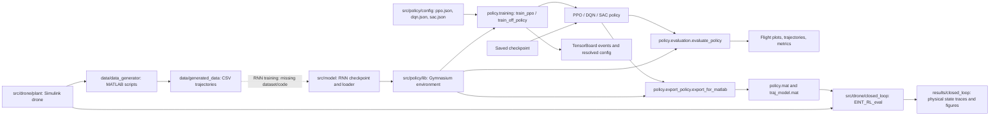
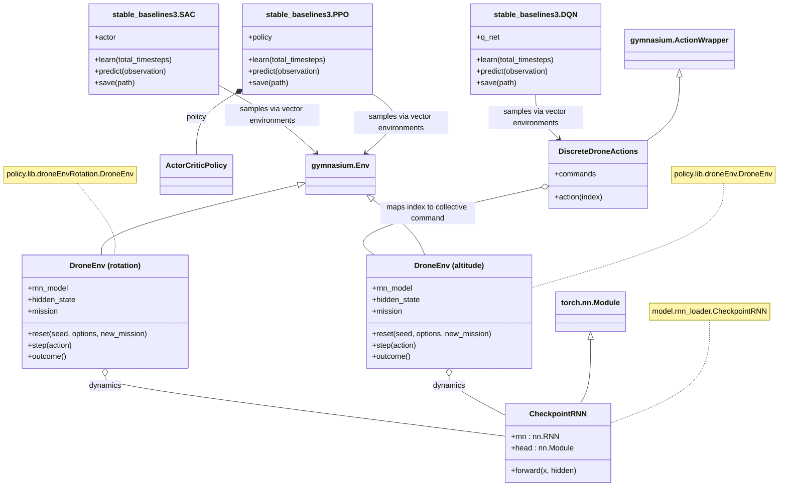

# Data-driven drone control

RNN dynamics, RL control and Simulink experiments for the
[EINT project](EINT_student_version_EN.pdf). The current experiment controls
altitude with a sampling period of 0.05 s. Yaw and x motion come later.

## Files

```text
data/
  initial_data/          Supplied measurements
  generated_data/        New training CSVs
  data_generator/        MATLAB generation scripts and CSV filter
src/
  main_model.py          Run the altitude RNN
  main_z.py              Choose a saved RL model, evaluate and export to MATLAB
  model/
    rnn_loader.py        Checkpoint loading
    checkpoints/        rnn_z.pt, rnn_z.onnx, rnn_z/ and rotation checkpoints
    training/           Existing RNN training scripts
    estimation/         RNN/EKF experiments and tests
    notebooks/          Model inspection
  policy/
    config/             ppo.json, dqn.json and sac.json training settings
    lib/
      droneEnv.py        Altitude environment
      droneEnvRotation.py  Rotation environment
      droneEnvGeneral.py   Historical general environment
      discrete_actions.py DQN command grid
    training.py         Choose and train PPO/DQN/SAC; export the trained agent
    evaluation.py       Flight metrics and plots
    export_policy.py    Altitude policy and mission export
    checkpoints/        Saved policies
    notebooks/          RL experiments and exercise template
  drone/
    plant/              Standalone Simulink drone and protected dynamics
    closed_loop/        Simulink controllers and policy evaluation
    visualization/      Optional Meshcat viewer
results/                Run outputs, ignored by Git
  altitude/             Python policy evaluations and training runs
  closed_loop/          Simulink trajectories and scope exports
```

`data/` and `.data/` inside extracted checkpoints are PyTorch tensor storage
and metadata, not datasets. Keep them beside `data.pkl`, `version` and
`byteorder`. The older 16-hidden-unit checkpoint is in
`src/model/checkpoints/legacy_z/`.

## Architecture



`main_model.py` runs dynamics inference. `policy/training.py` trains the chosen
policy and exports the selected checkpoint for MATLAB. `main_z.py` loads the
chosen RL model, evaluates the flight and exports the policy and mission.
The MATLAB generator uses the standalone
plant; closed-loop evaluation combines that plant with the exported policy.
The dashed link marks RNN training that still needs its missing inputs.

The UML below shows existing types. `AltitudeEnv` and `RotationEnv` are
labels for the two separately defined `DroneEnv` classes, not new classes.



The environments each hold their own recurrent state; training instances
share fixed RNN weights. Policies see observations and rewards from the selected
environment, rather than the mission schedule or RNN hidden state.

## Python

Run from the repository root with Python 3.10 or later:

```sh
python -m venv .venv
source .venv/bin/activate
python -m pip install -r requirements.txt
python src/main_model.py
python src/main_z.py --output-dir results/altitude/demo
```

`main_model.py` loads `src/model/checkpoints/rnn_z.pt` and runs 200 samples
with a constant command near hover. It saves `rnn_inference.csv`,
`rnn_inference.png` and `metrics.json` under `results/model/`.
To compare acceleration predictions with the first measured trajectory:

```sh
python src/main_model.py \
  --input-csv data/initial_data/bdd_in_mat_05.csv \
  --target-csv data/initial_data/bdd_out_mat_05.csv \
  --steps 200 --output-dir results/model/initial_data
```

Inputs are headerless CSVs with one trajectory per row; trailing commas are
accepted. Measurements may include sensor errors. The mains use the saved
altitude model's normalization constants; replacement checkpoints need the
same contract or their own training statistics.

`main_z.py` defaults to PPO. Its mission is 0 m until
2 s, 2 m until 6 s, then landing at −0.3 m, with a 10 s limit. Observations
contain only current altitude error, velocity and acceleration. The policy
has no access to the mission schedule.

The altitude tracking reward accepts a ±0.2 m band when `z_ref > 0`.
Inside that band the altitude penalty is zero; outside it, the penalty uses
the distance beyond the band. Zero and negative references keep the full
tracking error. Velocity, command, smoothness and terminal rewards are unchanged.

Runs save `flight.png`, `trajectory.csv`, `trajectory.npz`, `metrics.json`,
`policy.mat` and `traj_model.mat`. Use `--show` to display plots. Without an
output directory, each run gets a directory under
`results/altitude/<algorithm>/<timestamp>/`.
Set `RL_MODEL` at the top of `main_z.py`, or pass `--rl-model` to choose the
model to evaluate. Set `POLICY` at the top of `policy/training.py`, or pass
`--policy` to choose the algorithm to train. Both default to `ppo`.

```sh
python src/policy/training.py --policy ppo
python src/policy/training.py --policy dqn
python src/policy/training.py --policy sac
python src/main_z.py --rl-model sac
python src/main_z.py --rl-model sac \
  --rnn src/model/checkpoints/rnn_z.pt \
  --policy results/altitude/sac/<run>/training/sac_drone_rnn.zip \
  --output-dir results/altitude/sac_replay
```

The main finds the latest training run for the chosen algorithm under
`results/altitude/<algorithm>/`, then falls back to a supplied checkpoint.
Use `--policy PATH` to select an exact checkpoint.

The training script and main load `src/policy/config/<algorithm>.json`;
`--config` selects another file for that algorithm. Explicit `--steps` and
`--seed` arguments override
its values. Resolved settings are saved as `training/<algo>_config.json`
beside each run's checkpoints and monitor logs. These snapshots can also be
passed to `--config`. The RL notebook's PPO cell uses the same PPO config and
training function; its historical DQN/SAC cells keep their own settings.

All three configs start at 500,000 steps, learning rate 0.0001 and discount
0.99. DQN and SAC use four environments, a 100,000-transition replay buffer,
2,000 warmup steps, batches of 128 and two hidden layers of 64 units.
These are starting parameters, not validated optima for the mission.

| Algorithm | Collective command | Exploration |
| --- | --- | --- |
| PPO | Continuous, −3 to 3 | Existing Gaussian policy settings |
| DQN | 61 values, −3 to 3 in steps of 0.1 | Epsilon decreases from 1 to 0.05 over 80% of training |
| SAC | Continuous, −3 to 3 | State-dependent noise and learned entropy coefficient, initially 0.05 |

DQN checkpoints require the accompanying `commands.npy` in the same
directory. Evaluation plots, trajectory files and MATLAB exports contain
physical commands, not DQN indices. PPO has a supplied checkpoint; train
DQN/SAC first to make them available to the main.

Training may round the budget up to a complete rollout or collection block.
Training selects the best checkpoint when available and always saves the
final `<algorithm>_drone_rnn.zip`. The selected checkpoint is exported as
`training/policy.mat`, with its mission and model trajectory in
`training/traj_model.mat`. Training also evaluates that checkpoint and saves
flight plots and metrics in the run root.
The main also retains `--train` as a convenience; `--train` and `--policy`
are mutually exclusive. Supplied weights are preserved.

Training also saves `learning_curve.png` and TensorBoard events under
`training/tensorboard/<ALGO>_1/` (the suffix increments when reusing a directory).
`training.py` writes TensorBoard logs automatically, but does not start the
dashboard or open a browser. In a second terminal, with the same Python
environment activated and the repository as the current directory, run:

```sh
python -m tensorboard.main --logdir results --port 6006
```

Open [http://localhost:6006](http://localhost:6006/#scalars) in your browser for
episode rewards, losses and evaluation metrics. You can start TensorBoard
before training and leave it running; new logs appear as training progresses.
Evaluation metrics appear after 20,480 training steps.
Both mains accept absolute invocation paths; explicit relative arguments use
the current working directory.

## MATLAB

When `matlab` is on `PATH`, `main_z.py` runs the exported policy on the
Simulink plant automatically in batch mode. It saves the MATLAB console
output to `matlab.log` in the Python run directory and records the execution
status in `metrics.json`. Check that log if MATLAB reports a failure.
Without MATLAB, the main saves the export and prints the command to run on
a machine with MATLAB and Simulink.

To run the plant evaluation manually from the repository root:

```matlab
addpath('src/drone/closed_loop');
out = EINT_RL_eval(fullfile(pwd, 'results', 'altitude', 'demo'), 0.0);
```

This replays the exported policy against Python measurements, then runs
`EINT_RL_closed_loop.slx` with the standalone plant. Results go under
`results/closed_loop/<algorithm>/<run>/`:

- `traj_simulink.mat`: simulation output and plant signals.
- `trajectory.csv`: all 18 physical states, command and reference.
- `simulink_altitude.png` and `.fig`: altitude tracking and command.
- `scope_angles.png` and `.fig`: yaw, pitch and roll.
- `scope_states.png` and `.fig`: plant state traces.

The checked-in diagram has no Scope blocks; these figures plot the recorded
plant outputs. Pass a third argument to `EINT_RL_eval` to choose another
results directory. For a training run, pass its `training/` folder containing
the exported MAT files.

The export includes mission samples and checks policy outputs against
Stable-Baselines3. Commands use physical units: Python normalizes once before
RNN inference; MATLAB applies policy outputs directly to the plant. For DQN,
MATLAB selects the largest Q-value and maps its index through the exported grid.

The second argument is noise gain; use 0.0 for comparison. The existing plant
references `seed_theta` for pitch noise and runs the full horizon, including
after Python would stop at ground contact. MATLAB execution has not been
tested locally because the required runtimes are unavailable.

## Datasets and remaining experiments

Put new CSVs in `data/generated_data/`. Generation code is in
`data/data_generator/`; Simulink models stay in `src/drone/plant/`.
At the project's request, generator behavior is preserved: motor signals
assigned by the scripts are not connected to the checked-in diagram, and
`random_init.m` uses `Ts=0.00001` rather than the brief's 0.05 s.

The altitude trainer needs missing `rnn_input_z.csv` and `rnn_output_z.csv`:
1,000 commands and 3,000 interleaved `(z, vz, az)` values per trajectory.
The initial CSVs are 3,000 × 2,000 with acceleration-only outputs and cannot
replace them. The missing dataset/training code still needs to be supplied.
The rotation trainer does not reconstruct its saved checkpoint architecture.

The two environments stay separate to show the project's progression:

| Module | Observations | Actions | Reference |
| --- | --- | --- | --- |
| `policy.lib.droneEnv` | Altitude error, velocity, acceleration | Collective | `z_ref` |
| `policy.lib.droneEnvRotation` | 11 values; theta tracking disabled | `u_base`, `u_diff` | `(z_ref, phi_ref, psi_ref)` |

Rotation angular predictions and the assumed `tanh` head need validation.
The older four-motor policy/controller do not match the two-action environment.
The current main and MATLAB exporter support altitude only. Yaw/x mains are
pending. `rl_onnx.ipynb` needs the absent `rnn_model2.onnx`; other historical
notebooks keep their original numerical assumptions.

Existing estimator tests: `python -m unittest discover -s src/model/estimation -p test_rnn_ekf.py`.
The optional viewer needs Meshcat: `PYTHONPATH=src python -m drone.visualization.demo`.
